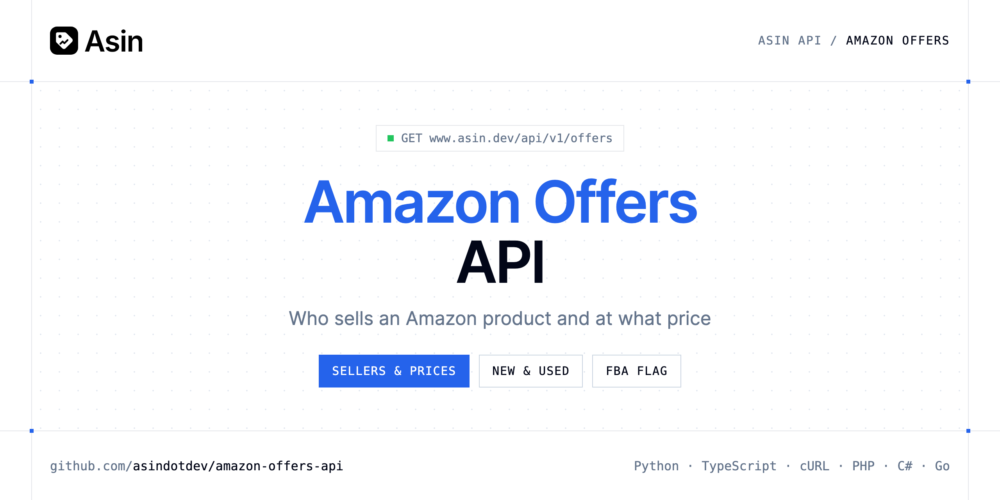

<p align="center">
  <a href="https://www.asin.dev"></a>
</p>

# Amazon Offers API

[](https://www.asin.dev/signup) [](https://www.asin.dev/docs) [](LICENSE)

The **Asin Amazon Offers API** tells you who sells a product and at what price, cheapest first, with Amazon's own price and the cheapest new and used offers.

- **Offers Already Known** — Who sells the product and at what price, as last read, cheapest first, with Amazon's own price and the cheapest new and used offers (used is only known for Amazon's own outlet).
- **Read Every Offer from Amazon** — Reads the offers on Amazon for 1 credit, refunded if it doesn't answer.

Use it to watch resellers, check Amazon's own price or find the cheapest offer for an ASIN.

| Endpoint | Request | Cost |
|---|---|---|
| [Offers Already Known](#offers-already-known) | `GET /offers` | Free |
| [Read Every Offer from Amazon](#read-every-offer-from-amazon) | `POST /offers` | 1 credit |

## Table of contents

- [How it works](#how-it-works)
- [Offers Already Known](#offers-already-known)
- [Read Every Offer from Amazon](#read-every-offer-from-amazon)
- [Code examples in other languages](#code-examples-in-other-languages)
- [Use cases](#use-cases)
- [Why Asin?](#why-asin)
- [FAQ](#faq)
- [Related repositories](#related-repositories)
- [Support](#support)

## How it works

1. **[Create an Asin account](https://www.asin.dev/signup)** and copy your API key from [your account](https://www.asin.dev/app#api).
2. **Call `https://www.asin.dev/api/v1`** with the header `Authorization: Bearer YOUR_API_KEY`.
3. **Use the result** in your app, or let Asin email you when a price moves.

```bash
export ASIN_API_KEY="your-api-key"
pip install requests        # Python
# TypeScript: Node.js 18+ (native fetch), run with `npx tsx file.ts`
```

## Offers Already Known

Who sells the product and at what price, as last read, cheapest first, with Amazon's own price and the cheapest new and used offers (used is only known for Amazon's own outlet). Free: this never reads Amazon or spends a credit. When nobody read this product's offers yet, the list is empty and fetched_at is null: POST /offers reads them.

`GET https://www.asin.dev/api/v1/offers` · **Free** · [API reference](https://www.asin.dev/docs)

### Request parameters

| Parameter | In | Type | Required | Description |
|---|---|---|---|---|
| `asin` | query | string | ✅ | 10-character ASIN |
| `marketplace` | query | string (`com`, `co.uk`, `de`, `fr`, `it`, `es`) | — | Amazon store, e.g. com for amazon.com |

### Python example

```python
import os

import requests

API_KEY = os.environ["ASIN_API_KEY"]
HEADERS = {"Authorization": f"Bearer {API_KEY}"}

response = requests.get(
    "https://www.asin.dev/api/v1/offers",
    headers=HEADERS,
    params={
        "asin": "B09DFCB66S",
        "marketplace": "com",
    },
    timeout=120,
)
response.raise_for_status()

data = response.json()
print(data)
```

### TypeScript example

```typescript
type OffersAlreadyKnown = {
  asin?: string;
  marketplace?: string;
  currency?: string;
  fetched_at?: string;
  charged?: boolean;
  amazon_price?: number;
  lowest_new_price?: number;
  lowest_used_price?: number;
  offers?: {
    seller?: string;
    seller_id?: string;
    price?: number;
    amazon?: boolean;
    fulfilled_by_amazon?: boolean;
    used?: boolean;
    delivery_time?: string;
    delivery_price?: string;
  }[];
};

const headers = { Authorization: `Bearer ${process.env.ASIN_API_KEY!}`, "Content-Type": "application/json" };

const params = new URLSearchParams({
  "asin": "B09DFCB66S",
  "marketplace": "com",
});

const response = await fetch(`https://www.asin.dev/api/v1/offers?${params}`, { headers });
if (!response.ok) throw new Error(`HTTP ${response.status}: ${await response.text()}`);

const data = (await response.json()) as OffersAlreadyKnown;
console.log(data);
```

### Output example

Example response from the API reference, abridged.

```json
{
  "asin": "B09DFCB66S",
  "marketplace": "com",
  "currency": "USD",
  "fetched_at": "2026-11-03T08:00:12.441Z",
  "charged": false,
  "amazon_price": 79.99,
  "lowest_new_price": 74.5,
  "lowest_used_price": 61.2,
  "offers": [
    {
      "seller": "example",
      "seller_id": null,
      "price": 61.2,
      "amazon": false,
      "fulfilled_by_amazon": false,
      "used": true,
      "delivery_time": "Friday, November 6",
      "delivery_price": "FREE"
    },
    {
      "seller": "example",
      "seller_id": "A10IJ5BG4OYOQ1",
      "price": 74.5,
      "amazon": false,
      "fulfilled_by_amazon": true,
      "used": false,
      "delivery_time": "Friday, November 6",
      "delivery_price": "FREE"
    }
  ]
}
```

### Response fields

| Field | Type | Description |
|---|---|---|
| `asin` | string | 10-character ASIN |
| `marketplace` | string | Amazon store |
| `currency` | string | ISO 4217 code of the marketplace |
| `fetched_at` | string | When Amazon was read; null when nobody asked yet |
| `charged` | boolean | Whether this answer used a credit |
| `amazon_price` | number | Amazon's own offer, when Amazon sells it |
| `lowest_new_price` | number | Cheapest offer that isn't used |
| `lowest_used_price` | number | Cheapest used or renewed offer, when Amazon's outlet has one |
| `offers[]` | object[] |  |
| `offers[].seller` | string | Seller's name |
| `offers[].seller_id` | string | Amazon's id of the seller |
| `offers[].price` | number | Price of the offer |
| `offers[].amazon` | boolean | Sold by Amazon itself |
| `offers[].fulfilled_by_amazon` | boolean | Shipped by Amazon |
| `offers[].used` | boolean | Used or renewed |
| `offers[].delivery_time` | string | Delivery date, as Amazon says it |
| `offers[].delivery_price` | string | Delivery cost, as Amazon says it |

## Read Every Offer from Amazon

Reads the offers on Amazon for 1 credit, refunded if it doesn't answer. A read made in the last 3 hours, by anyone, is returned instead, for free (charged: false). The answer is the same as GET /offers.

`POST https://www.asin.dev/api/v1/offers` · **1 credit** · [API reference](https://www.asin.dev/docs)

### Request parameters

| Parameter | In | Type | Required | Description |
|---|---|---|---|---|
| `asin` | body | string | ✅ | 10-character ASIN |
| `marketplace` | body | string (`com`, `co.uk`, `de`, `fr`, `it`, `es`) | — | Amazon store, e.g. com for amazon.com |
| `refresh` | body | boolean | — | Read Amazon again unless the last read is under 5 minutes old (1 credit) |

### Python example

```python
import os

import requests

API_KEY = os.environ["ASIN_API_KEY"]
HEADERS = {"Authorization": f"Bearer {API_KEY}"}

response = requests.post(
    "https://www.asin.dev/api/v1/offers",
    headers=HEADERS,
    json={'asin': 'B09DFCB66S', 'marketplace': 'com'},
    timeout=120,
)
response.raise_for_status()

data = response.json()
print(data)
```

### TypeScript example

```typescript
type ReadEveryOfferFromAmazon = {
  asin?: string;
  marketplace?: string;
  currency?: string;
  fetched_at?: string;
  charged?: boolean;
  amazon_price?: number;
  lowest_new_price?: number;
  lowest_used_price?: number;
  offers?: {
    seller?: string;
    seller_id?: string;
    price?: number;
    amazon?: boolean;
    fulfilled_by_amazon?: boolean;
    used?: boolean;
    delivery_time?: string;
    delivery_price?: string;
  }[];
};

const headers = { Authorization: `Bearer ${process.env.ASIN_API_KEY!}`, "Content-Type": "application/json" };

const response = await fetch("https://www.asin.dev/api/v1/offers", {
  method: "POST",
  headers,
  body: JSON.stringify({
  "asin": "B09DFCB66S",
  "marketplace": "com"
}),
});
if (!response.ok) throw new Error(`HTTP ${response.status}: ${await response.text()}`);

const data = (await response.json()) as ReadEveryOfferFromAmazon;
console.log(data);
```

### Output example

Example response from the API reference, abridged.

```json
{
  "asin": "B09DFCB66S",
  "marketplace": "com",
  "currency": "USD",
  "fetched_at": "2026-11-03T08:00:12.441Z",
  "charged": true,
  "amazon_price": 79.99,
  "lowest_new_price": 74.5,
  "lowest_used_price": 61.2,
  "offers": [
    {
      "seller": "example",
      "seller_id": null,
      "price": 61.2,
      "amazon": false,
      "fulfilled_by_amazon": false,
      "used": true,
      "delivery_time": "Friday, November 6",
      "delivery_price": "FREE"
    },
    {
      "seller": "example",
      "seller_id": "A10IJ5BG4OYOQ1",
      "price": 74.5,
      "amazon": false,
      "fulfilled_by_amazon": true,
      "used": false,
      "delivery_time": "Friday, November 6",
      "delivery_price": "FREE"
    }
  ]
}
```

### Response fields

| Field | Type | Description |
|---|---|---|
| `asin` | string | 10-character ASIN |
| `marketplace` | string | Amazon store |
| `currency` | string | ISO 4217 code of the marketplace |
| `fetched_at` | string | When Amazon was read; null when nobody asked yet |
| `charged` | boolean | Whether this answer used a credit |
| `amazon_price` | number | Amazon's own offer, when Amazon sells it |
| `lowest_new_price` | number | Cheapest offer that isn't used |
| `lowest_used_price` | number | Cheapest used or renewed offer, when Amazon's outlet has one |
| `offers[]` | object[] |  |
| `offers[].seller` | string | Seller's name |
| `offers[].seller_id` | string | Amazon's id of the seller |
| `offers[].price` | number | Price of the offer |
| `offers[].amazon` | boolean | Sold by Amazon itself |
| `offers[].fulfilled_by_amazon` | boolean | Shipped by Amazon |
| `offers[].used` | boolean | Used or renewed |
| `offers[].delivery_time` | string | Delivery date, as Amazon says it |
| `offers[].delivery_price` | string | Delivery cost, as Amazon says it |

## Code examples in other languages

Ready-to-run examples live in [`examples/`](examples); each reads your key from `ASIN_API_KEY`.

| Language | `get-offers` | `read-offers` |
|---|---|---|
| cURL (Bash) | [get_offers.sh](examples/curl/get_offers.sh) | [read_offers.sh](examples/curl/read_offers.sh) |
| PHP | [get_offers.php](examples/php/get_offers.php) | [read_offers.php](examples/php/read_offers.php) |
| C# | [GetOffers.cs](examples/csharp/GetOffers.cs) | [ReadOffers.cs](examples/csharp/ReadOffers.cs) |
| Go | [get_offers.go](examples/go/get_offers.go) | [read_offers.go](examples/go/read_offers.go) |
| Java | [GetOffersExample.java](examples/java/GetOffersExample.java) | [ReadOffersExample.java](examples/java/ReadOffersExample.java) |
| Ruby | [get_offers.rb](examples/ruby/get_offers.rb) | [read_offers.rb](examples/ruby/read_offers.rb) |
| Node.js | [get_offers.mjs](examples/nodejs/get_offers.mjs) | [read_offers.mjs](examples/nodejs/read_offers.mjs) |

## Use cases

- **Reseller monitoring** — See which sellers offer your products and at what price.
- **Cheapest offer** — Get the lowest new and used prices for an ASIN.
- **Amazon vs sellers** — Compare Amazon's own price with third-party offers.

## Why Asin?

- **A watchlist that runs on its own** — each product is checked on schedule, from every 5 minutes to every 24 hours depending on the plan.
- **Price history for any ASIN** — read every price Asin has seen, free and without tracking the product.
- **Alerts by email** — price drops, target prices and products back in stock.
- **Pay for what you check** — each price check costs 1 credit (about 30 credits a month for a product checked daily) and failed checks are refunded. Free for 50 products.
- **Use it your way** — the same API key works with the REST API, the MCP server and the Chrome extension, with official SDKs in 7 languages.
- **Copy-paste examples** — Python and TypeScript in each README, 7 more languages in `examples/`.

## FAQ

### How do I authenticate?

[Create an Asin account](https://www.asin.dev/signup), copy your API key from [your account](https://www.asin.dev/app#api) and send it as `Authorization: Bearer YOUR_API_KEY` with every request to `https://www.asin.dev/api/v1`. Keys start with `asin_`.

### How much does it cost?

`GET /offers`: Free, `POST /offers`: 1 credit. Asin is free for 50 products; a product checked daily uses about 30 credits a month and failed checks are refunded. See [Asin pricing](https://www.asin.dev/pricing).

### What is the difference between GET and POST?

`GET /offers` returns what is already known, for free, and never reads Amazon. `POST /offers` reads Amazon for 1 credit, refunded if it doesn't answer; a read made in the last 3 hours, by anyone, is returned for free instead (`charged: false`).

### Why is the list empty?

Nobody read this product's offers yet: `fetched_at` is null. Call `POST /offers`.

### Which Amazon stores are supported?

11 marketplaces, set with `marketplace`: `com` (default), `co.uk`, `de`, `fr`, `it`, `es`, `ca`, `co.jp`, `com.br`, `com.mx` and `in`.

### Is there an official SDK?

Yes: [Python](https://github.com/asindotdev/asin-python), [Node.js & TypeScript](https://github.com/asindotdev/asin-node), [Go](https://github.com/asindotdev/asin-go), [PHP](https://github.com/asindotdev/asin-php), [Ruby](https://github.com/asindotdev/asin-ruby), [Java](https://github.com/asindotdev/asin-java) and [.NET](https://github.com/asindotdev/asin-dotnet), plus a [CLI](https://github.com/asindotdev/asin-cli) and an [MCP server](https://github.com/asindotdev/asin-mcp). The examples here use plain HTTP so you can see the raw API.

### Which languages are supported?

Any language that can make an HTTP request. This README shows Python and TypeScript; the [`examples/`](examples) folder contains cURL, PHP, C#, Go, Java, Ruby and Node.js.

## Related repositories

- [Amazon Price Tracker API](https://github.com/asindotdev/amazon-price-tracker-api)
- [Amazon Price History API](https://github.com/asindotdev/amazon-price-history-api)
- [Amazon Price Alerts API](https://github.com/asindotdev/amazon-price-alerts-api)
- [Amazon Search API](https://github.com/asindotdev/amazon-search-api)
- [All Asin repositories](https://github.com/asindotdev)

## Support

- 📚 Read the [API reference](https://www.asin.dev/docs).
- ✉️ Write to [contact@asin.dev](mailto:contact@asin.dev).
- 🔑 [Get your API key](https://www.asin.dev/signup).

---

<p align="center">
  <a href="https://www.asin.dev">
    <picture>
      <source media="(prefers-color-scheme: dark)" srcset="images/logo-dark.svg">
      
    </picture>
  </a>
  <br>
  <sub>Built by <a href="https://www.asin.dev">Asin</a>. Examples are released under the MIT license.</sub>
</p>
